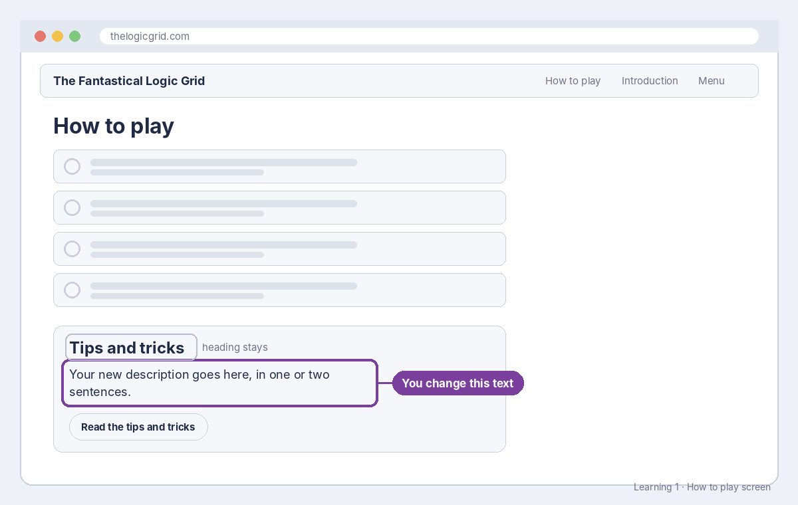

# Build sheet: Learning 1, Tips and tricks description

Issue #135 · File `web/index.html` · About 10 minutes · Reference: [HTML text](../reference/html-text.md)

## What it should look like



On the **How to play** screen, the *Tips and tricks* card shows your sentence under its heading, above the **Read the tips and tricks** button.

## What you changed

```html
<div class="card tips-card">
  <h2>Tips and tricks</h2>
  <p>Your new description, in one or two sentences.</p>
  <button class="btn" type="button" id="learn-tips-btn">Read the tips and tricks</button>
</div>
```

## The code, line by line

| Line | What it means |
| --- | --- |
| `<div class="card tips-card">` | A box. `class` names the look (a card) from the style sheet. |
| `<h2>Tips and tricks</h2>` | The card's heading. `h2` means a second-level heading. |
| `<p>...</p>` | **Your change.** `p` is a paragraph: everything between the tags shows as text. |
| `<button ... id="learn-tips-btn">` | The button. The `id` is how the game's code finds it, so it must never change. |
| `</div>` | Closes the box. Every opening tag has a closing tag with a `/`. |

## How to check it worked

- The pull request's **Tests** check is green.
- Only the words between `<p>` and `</p>` changed (GitHub's **Files changed** tab shows one red line and one green line).
- After it's merged and the site updates, open **How to play** and read your sentence on the card.
