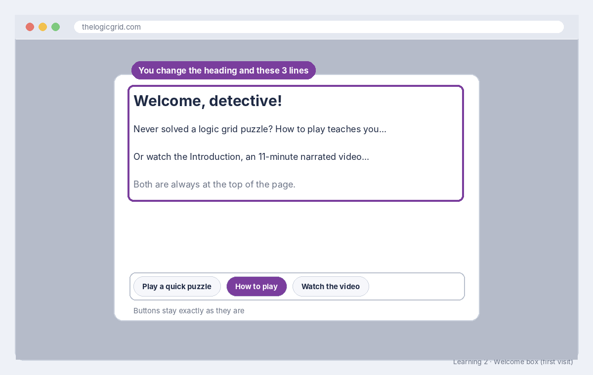

# Build sheet: Learning 2, Welcome message

Issue #136 · File `web/index.html` · About 15 minutes · Reference: [HTML text](../reference/html-text.md)

## What it should look like



A first-time visitor sees a box in the middle of a dimmed page: your heading, your three short lines, then the three buttons (**Play a quick puzzle**, **How to play**, **Watch the video**), unchanged.

## What you changed

```html
<dialog id="dlg-welcome" aria-labelledby="welcome-h">
  <h2 id="welcome-h">Your heading</h2>
  <p>Your first line, with <b>How to play</b> in bold.</p>
  <p>Your second line, with <b>Introduction</b> in bold.</p>
  <p class="muted">Your third line.</p>
  <div class="dlg-actions">...the buttons, unchanged...</div>
</dialog>
```

## The code, line by line

| Line | What it means |
| --- | --- |
| `<dialog id="dlg-welcome" ...>` | A pop-up box. The game opens it by its `id`, so the id never changes. |
| `aria-labelledby="welcome-h"` | Tells screen readers to read the heading with id `welcome-h` as the box's name. Accessibility: keep it. |
| `<h2 id="welcome-h">...</h2>` | **Your heading.** Change the words only, never the `id`. |
| `<p>...</p>` | **Your lines.** Paragraphs of text. |
| `<b>...</b>` | Bold. Keep **How to play** and **Introduction** bold so they match the buttons. |
| `class="muted"` | Shows that line in a softer gray. Keep the class; change the words. |
| `<div class="dlg-actions">` | The button row. Leave all of it exactly as it is. |

## How to check it worked

- The **Tests** check is green (it opens this box and clicks its buttons).
- **Files changed** shows changes only inside the heading and the three `<p>` lines.
- After merge: open the site in a private window (it shows the welcome box only on a first visit) and read your message.
