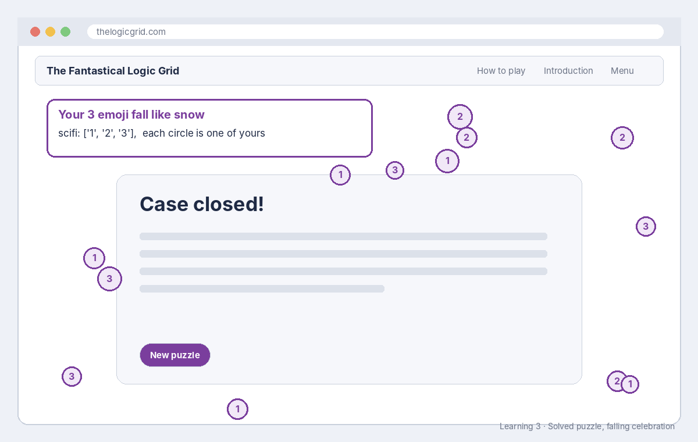

# Build sheet: Learning 3, Falling celebration emoji

Issue #137 · File `web/js/effects.js` · About 10 minutes · Reference: [JavaScript lists](../reference/javascript-lists.md)

## What it should look like



When a puzzle in your chosen theme is solved and the **falling** celebration plays, your three emoji drift down the screen like snow around the *Case closed!* panel. An emoji listed twice falls about twice as often.

## What you changed

```js
const FALLING = {
  holiday: ['❄️', '❄️', '⛄'], parks: ['🍂', '🍁', '🍃'],
  // ...the other themes...
  scifi: ['⭐', '🌠', '✨'],
};
```

## The code, line by line

| Piece | What it means |
| --- | --- |
| `const FALLING = { ... };` | A named lookup table (an *object*). `const` means the name always points to this table. |
| `scifi:` | The key: which theme this line is for. It must be a theme id exactly (lowercase). |
| `[ ... ]` | A list (an *array*) of things to fall. |
| `'⭐'` | One item: text in single quotes. Emoji count as text. |
| `,` between items | Separates items in the list. |
| `,` at the end of the line | Separates this theme from the next one. |

The game reads the list when the celebration starts: `FALLING[theme]` means "the list for this puzzle's theme". If a theme has no list, it uses the season's snow, petals or leaves.

## How to check it worked

- The **Tests** check is green. A missing quote or comma breaks the whole file, and the tests catch that.
- After merge: in the admin dashboard, set celebrations to include falling snow/leaves/petals, solve a puzzle in your theme, and watch your emoji fall.
