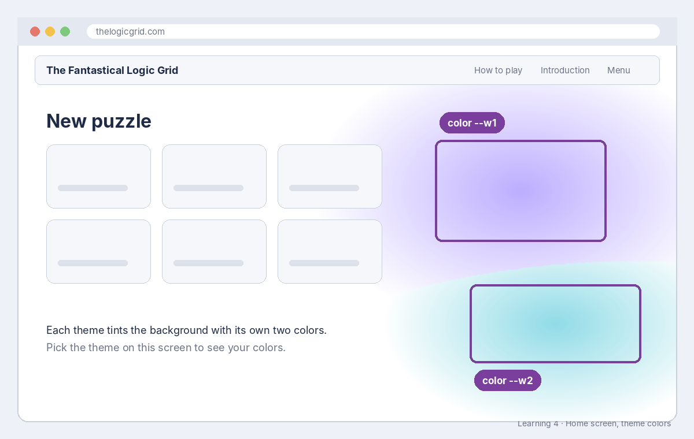

# Build sheet: Learning 4, Theme colors

Issue #138 · File `web/app.css` · About 15 minutes · Reference: [CSS colors](../reference/css-colors.md)

## What it should look like



When a player picks your theme, the page's background picks up two soft glows in your colors. The same pair also makes the theme's icon tile on the New puzzle screen: a fade from `--w1` to `--w2` with a **white icon** on top, so both colors must be dark enough for white to stand out.

## What you changed

```css
:root[data-world="action"] { --w1: #EF4444; --w2: #F59E0B; }
```

## The code, line by line

| Piece | What it means |
| --- | --- |
| `:root` | The whole page. |
| `[data-world="action"]` | Only when the page is showing the Action theme. The game sets `data-world` for you. |
| `{ ... }` | The settings that apply then. |
| `--w1: #EF4444;` | A *custom property* (a named color) called `--w1`, set to a red. Each setting ends with `;`. |
| `#EF4444` | A hex color: red `EF`, green `44`, blue `44`, each from `00` (none) to `FF` (full). |

Elsewhere, the style sheet uses `var(--w1)` and `var(--w2)` to paint the glows, so changing these two values recolors every place at once.

## How to check it worked

- The **Tests** check is green.
- **Files changed** shows one line changed, with only the two color codes different.
- Check contrast before you commit: at [webaim.org/resources/contrastchecker](https://webaim.org/resources/contrastchecker/), put `#FFFFFF` as the foreground and each of your colors as the background. Aim for at least 3:1 (the icon is a graphic).
- After merge: pick the theme on the New puzzle screen, in both light and dark mode (Settings), and check the glows and the white icon.
