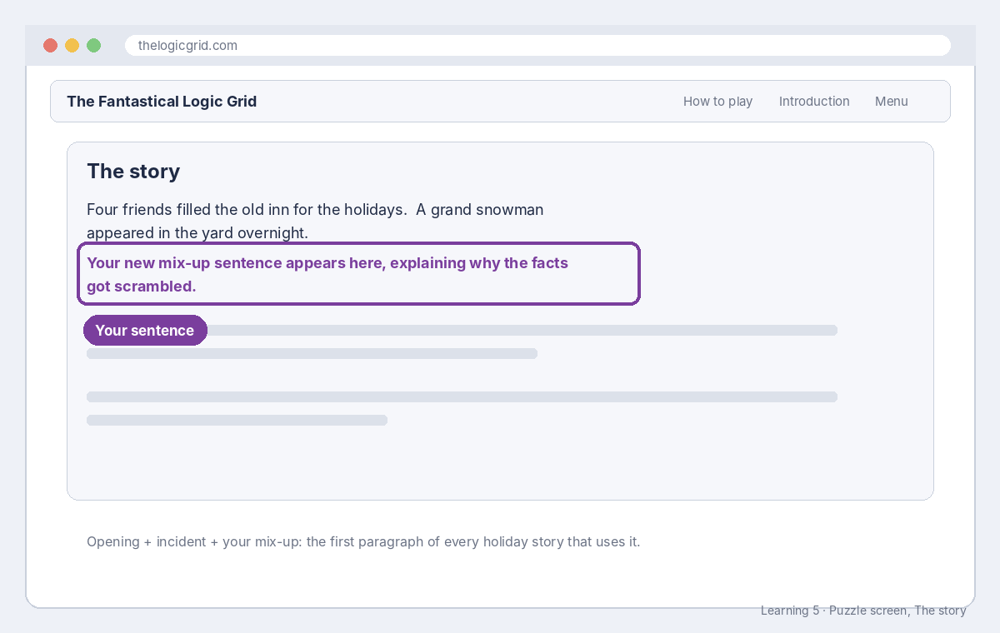

# Build sheet: Learning 5, Holiday story mix-up

Issue #139 · File `engine/src/more-stories.js` · About 15 minutes · Reference: [Story parts](../reference/story-parts.md)

## What it should look like



In new Holiday stories, your sentence can appear as the third sentence of the story's first paragraph, after the scene and the event, explaining why the clues are needed.

## What you changed

```js
export const MORE_STORIES = {
  holiday: {
    // ...
    mishaps: [
      'The holiday letter went out with all the names mixed up.',
      // ...the others...
      'Your sentence, in your own words.',
    ],
```

## The code, line by line

| Piece | What it means |
| --- | --- |
| `holiday: { ... }` | Extra story parts for the Holiday theme. |
| `mishaps: [ ... ]` | The list of mix-up sentences ("mishap" is the code's word for a mix-up). |
| `'...'` | One sentence, in single quotes. |
| `\'` | An apostrophe inside the sentence needs a backslash, so the quote doesn't end early. |
| `,` | Ends each item. |

Why at the **end**: every story remembers its parts by their position in the list. Adding to the end keeps every saved story pointing at the same sentences.

## How to check it worked

- The **Tests** check is green. The tests build stories with your sentence and check it never names a gift, treat, decoration or person.
- After merge: play a few Holiday puzzles. Your line appears in some of them, since each story picks one mix-up at random.
- This sentence is your own writing, so keep the pull request as part of your authorship record.
