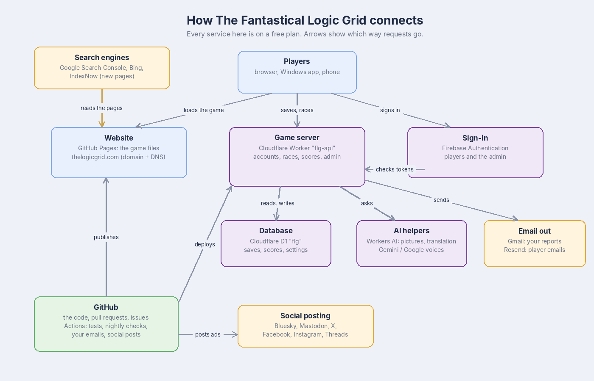

# Build sheet: Learning 6, How the game runs

Issue #140 · Reading only · About 10 minutes · Tutorials: [How the game runs](../reference/how-the-game-runs.md), [How it looks after itself](../reference/maintenance.md)

## The map you explored

## Recap in five lines

- **GitHub Pages** hands players the game's files. Puzzles are made on the player's own device.
- **Cloudflare** runs the game server and its database: accounts, saves, races, scores, the admin dashboard.
- **Firebase** checks sign-ins. The game never sees anyone's password.
- **GitHub Actions** is the robot: it tests every change, publishes the site, runs the nightly checks and sends your emails.
- Services trust each other with **keys** kept in locked boxes; the code only ever names them.

## Self-check

| Question | Answer |
| --- | --- |
| The game server is down. Can people still play? | Yes: solo play works. Accounts, races and syncing pause until it's back. |
| Where do you replace the Gmail app password? | GitHub > Settings > Secrets and variables > Actions, secret `GMAIL_APP_PASSWORD`. |
| A `health-check` issue opened overnight. First step? | Wait an hour. Most outages fix themselves and the issue closes on its own. |
| Why did a Dependabot pull request not merge itself? | It's a big update, or its tests failed. It waits for a person. |
| What stops scheduled jobs after 60 quiet days? | GitHub pauses them in inactive repositories; re-enable them in the Actions tab. |

## What's next

The next coding tasks build on this: for example, adding a link on the website, or turning a dashboard switch on and checking that it shows in the game.
